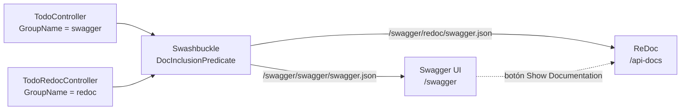

[English](README.md) · **Español**

# 📘 Swagger + ReDoc en ASP.NET Core


**Una API en ASP.NET Core con dos sitios de documentación: Swagger UI interactivo para desarrolladores y una página de ReDoc prolija para quienes consumen la API.**

---

## Sobre el proyecto

Swagger UI es ideal para probar endpoints, pero no es la mejor página para entregarle a quienes consumen una API. ReDoc se lee mejor, pero no permite enviar requests. Esta prueba de concepto sirve las dos desde el mismo proyecto y decide, controller por controller, qué endpoints aparecen en cada una.

## Capturas

<!-- TODO: agregar capturas de las dos páginas -->
| Swagger UI (`/swagger`) | ReDoc (`/api-docs`) |
| --- | --- |
|  |  |

## Cómo funciona



- **Dos documentos OpenAPI, un solo generador.** Swashbuckle registra un documento `swagger` y otro `redoc`. Cada controller declara a cuál pertenece con `[ApiExplorerSettings(GroupName = "...")]`, y un `DocInclusionPredicate` envía cada endpoint al documento correspondiente.
- **Documentación completa para ReDoc.** `TodoRedocController` usa `[SwaggerOperation]` y `[SwaggerResponse]` para resúmenes, descripciones y códigos de respuesta, y sus modelos usan `[SwaggerSchema]` y `[Description]`.
- **Soporte de `[Description]`.** Swashbuckle no publica por sí solo el `System.ComponentModel.DescriptionAttribute`, así que `DescriptionSchemaFilter` lo copia al esquema de cada propiedad.
- **Personalización de Swagger UI.** Un tema oscuro inyectado como CSS (se aplica cuando el sistema está en modo oscuro) y un script que agrega un botón *Show Documentation* que lleva a ReDoc.

## Endpoints

| Controller | Documento | Endpoints | Comportamiento |
| --- | --- | --- | --- |
| `TodoController` | Swagger | `GET /api/Todo` · `GET /api/Todo/{id}` · `POST` · `PUT {id}` · `DELETE {id}` | CRUD en memoria funcional |
| `TodoRedocController` | ReDoc | `GET /api/TodoRedoc/tasks` · `GET /api/TodoRedoc/{id}` · `POST` · `PUT {id}` · `DELETE {id}` | Respuestas de ejemplo para mostrar la documentación |

<details>
<summary><b>Estructura del proyecto</b></summary>

```text
ApiRedoc/ApiRedoc/
├── Controllers/
│   ├── ToDoController.cs           CRUD en memoria, publicado en Swagger
│   └── TodoRedocController.cs      Endpoints documentados, publicados en ReDoc
├── Filters/
│   └── DescriptionSchemaFilter.cs  Copia [Description] al esquema
├── ViewModels/                     Modelos de request y response
├── wwwroot/
│   ├── SwaggerDark.css             Tema oscuro para Swagger UI
│   └── button-doc.js               Botón "Show Documentation"
└── Program.cs                      Los dos documentos y el filtro por grupo
```

</details>

## Cómo ejecutar el proyecto

### Requisitos

- .NET 6 SDK, o un SDK más nuevo con el runtime de .NET 6

### Ejecutar

```bash
git clone https://github.com/EmilianoBazanZapata/REDOC---.NET.git
cd REDOC---.NET/ApiRedoc
dotnet run --project ApiRedoc
```

Después abrir:

- Swagger UI: `https://localhost:7111/swagger`
- ReDoc: `https://localhost:7111/api-docs`

## Créditos

Hecho por Emiliano Bazán-Zapata.
<!-- TODO: dar crédito al autor original de SwaggerDark.css si proviene de un tema de la comunidad -->

---

**Binary Suns Studio** · [Web](https://binarysunsstudio.com.ar) · [GitHub](https://github.com/EmilianoBazanZapata) · [LinkedIn](https://www.linkedin.com/in/emiliano-bazán-zapata-18705721a)
