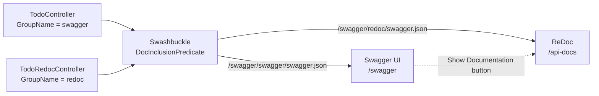

**English** · [Español](README.es.md)

# 📘 Swagger + ReDoc in ASP.NET Core


**One ASP.NET Core API, two documentation sites: an interactive Swagger UI for developers and a clean ReDoc page for API consumers.**

---

## About the project

Swagger UI is great for trying endpoints, but it's not the best page to hand to the people who consume an API. ReDoc reads better, but it can't send requests. This proof of concept serves both from the same project and decides, per controller, which endpoints appear in each one.

## Screenshots

<!-- TODO: add screenshots of both pages -->
| Swagger UI (`/swagger`) | ReDoc (`/api-docs`) |
| --- | --- |
|  |  |

## How it works



- **Two OpenAPI documents, one generator.** Swashbuckle registers a `swagger` document and a `redoc` document. Each controller declares where it belongs with `[ApiExplorerSettings(GroupName = "...")]`, and a `DocInclusionPredicate` sends every endpoint to the right document.
- **Rich documentation for ReDoc.** `TodoRedocController` uses `[SwaggerOperation]` and `[SwaggerResponse]` for summaries, descriptions and response codes, and its models use `[SwaggerSchema]` and `[Description]`.
- **`[Description]` support.** Swashbuckle doesn't publish `System.ComponentModel.DescriptionAttribute` on its own, so `DescriptionSchemaFilter` copies it into the schema of each property.
- **Swagger UI customization.** A dark theme injected as CSS (applied when the OS is in dark mode) and a script that adds a *Show Documentation* button linking to ReDoc.

## Endpoints

| Controller | Document | Endpoints | Behavior |
| --- | --- | --- | --- |
| `TodoController` | Swagger | `GET /api/Todo` · `GET /api/Todo/{id}` · `POST` · `PUT {id}` · `DELETE {id}` | Working in-memory CRUD |
| `TodoRedocController` | ReDoc | `GET /api/TodoRedoc/tasks` · `GET /api/TodoRedoc/{id}` · `POST` · `PUT {id}` · `DELETE {id}` | Sample responses to showcase the documentation |

<details>
<summary><b>Project structure</b></summary>

```text
ApiRedoc/ApiRedoc/
├── Controllers/
│   ├── ToDoController.cs           In-memory CRUD, published in Swagger
│   └── TodoRedocController.cs      Documented endpoints, published in ReDoc
├── Filters/
│   └── DescriptionSchemaFilter.cs  Copies [Description] into the schema
├── ViewModels/                     Request and response models
├── wwwroot/
│   ├── SwaggerDark.css             Dark theme for Swagger UI
│   └── button-doc.js               "Show Documentation" button
└── Program.cs                      Both documents and the group filter
```

</details>

## Getting started

### Requirements

- .NET 6 SDK, or a newer SDK with the .NET 6 runtime

### Run

```bash
git clone https://github.com/EmilianoBazanZapata/REDOC---.NET.git
cd REDOC---.NET/ApiRedoc
dotnet run --project ApiRedoc
```

Then open:

- Swagger UI: `https://localhost:7111/swagger`
- ReDoc: `https://localhost:7111/api-docs`

## Credits

Built by Emiliano Bazán-Zapata.
<!-- TODO: credit the original author of SwaggerDark.css if it comes from a community theme -->

---

**Binary Suns Studio** · [Website](https://binarysunsstudio.com.ar) · [GitHub](https://github.com/EmilianoBazanZapata) · [LinkedIn](https://www.linkedin.com/in/emiliano-bazán-zapata-18705721a)
